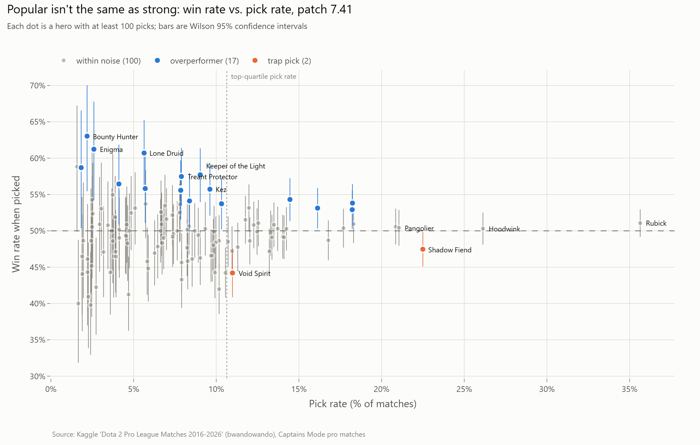
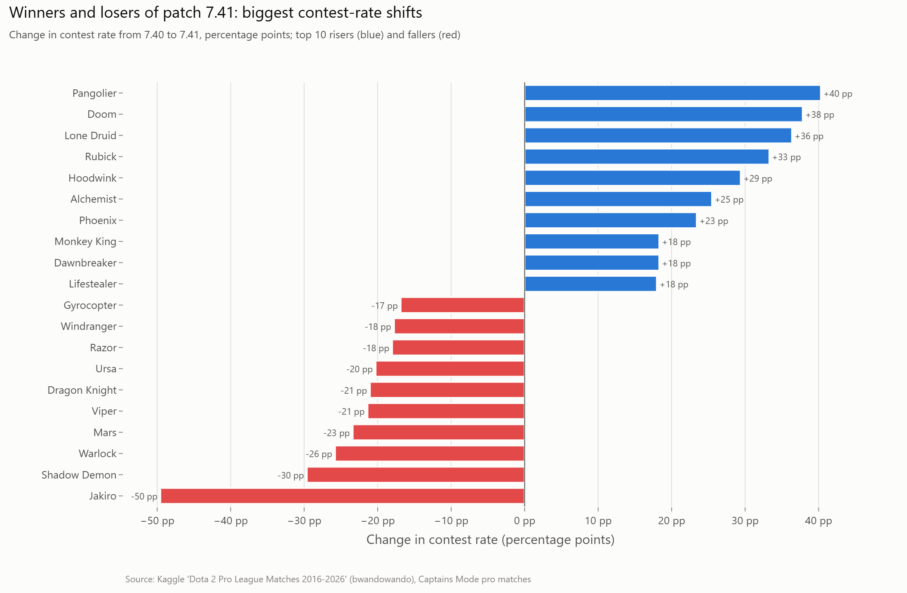
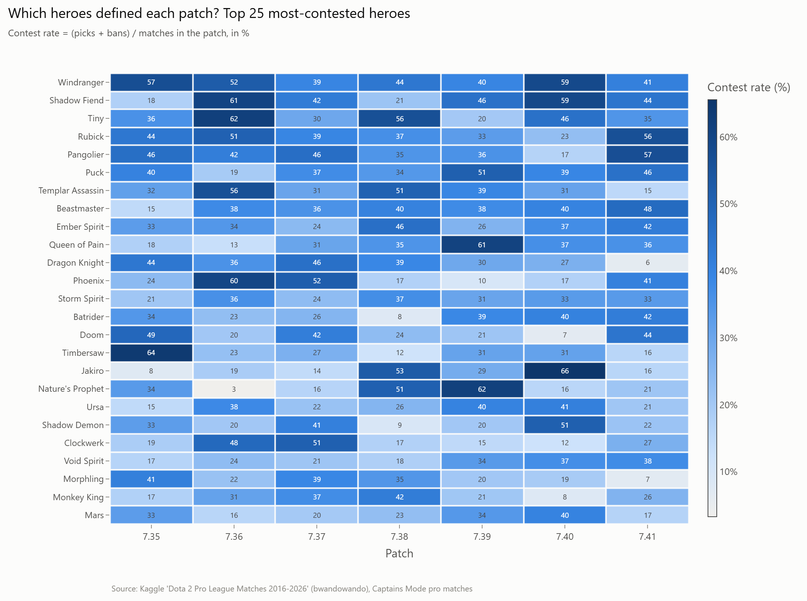
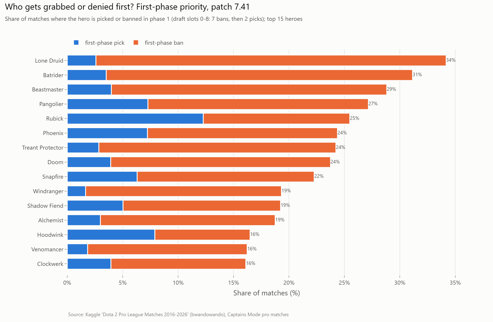
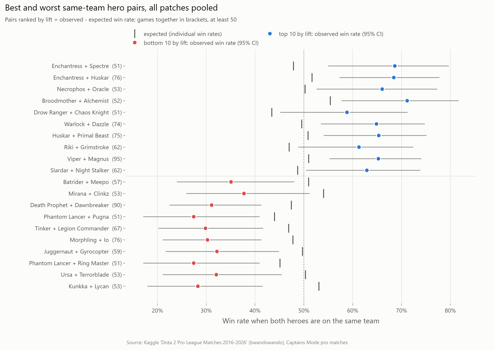
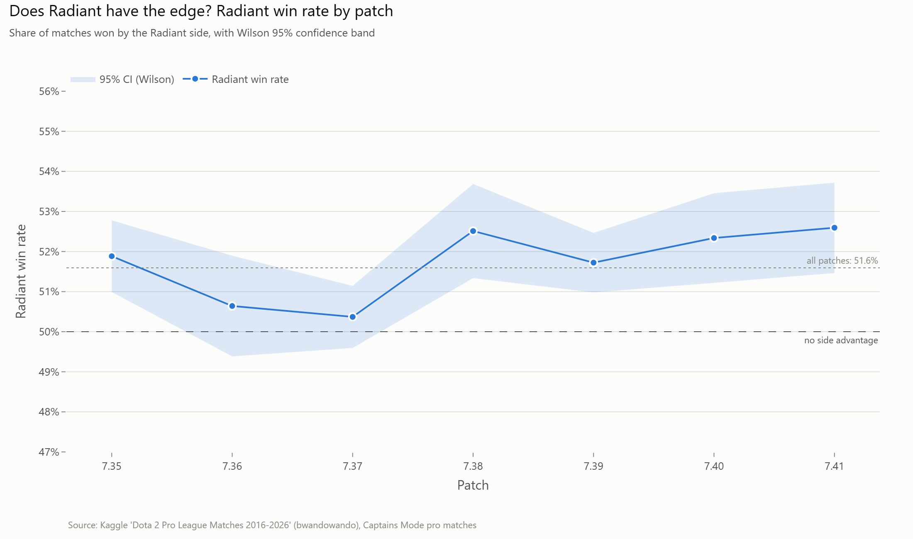
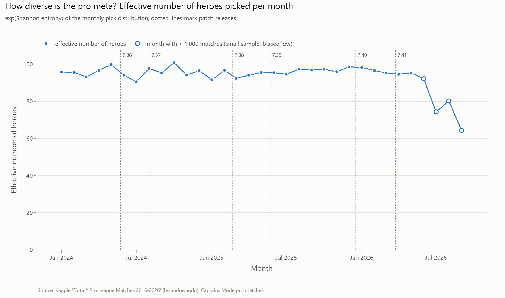

# Dota 2 Pro Meta & Draft Analysis

Every Dota 2 patch reshuffles which of the 127 heroes professional teams fight over in the draft. This project takes **73,599 Captains Mode pro matches (Jan 2024 to Sep 2026, seven patches from 7.35 to 7.41)** and builds a reproducible SQL pipeline on DuckDB to answer the questions a drafter or analyst actually asks. Which heroes define a patch? Which popular picks quietly lose? What do teams take or deny first? Do hero pairs really "synergise"? Does the Radiant side have an edge? Every rate comes with a sample size, and win rates come with a confidence interval, because in pro Dota most eye-catching win rates are small-sample noise.

**Live dashboard:** _[link coming soon: Streamlit Community Cloud]_

## Key findings

**1. Being contested doesn't mean winning.** In patch 7.41, Rubick is picked in **35.6%** of matches but wins **51.1%** of them (95% CI 49.2–52.9%), which is indistinguishable from a coin flip. **Shadow Fiend** is picked in **22.5%** of matches but wins only **47.5%** (CI 45.1–49.8%), so it's a *trap pick*. Meanwhile, niche heroes like **Lone Druid** (5.6% pick rate, 60.7% win rate, CI 56.0–65.2%) and **Keeper of the Light** (9.0%, 57.7%, CI 54.0–61.4%) clearly overperform. Every patch has between 0 and 5 trap picks.



**2. Patches flip the meta hard, and the top hero always falls.** In all six patch changes, the previous patch's most-contested hero became the **biggest faller** in the next patch: Timbersaw, Weaver, Phoenix, Tiny, Nature's Prophet and Jakiro. **Jakiro** went from the most-contested hero of 7.40 (**65.6%** of matches) to **16.0%** in 7.41, a fall of 49.6 percentage points, while **Pangolier** rose from **16.7%** to **57.0%**.




**3. The first draft phase is about denial, and teams deny the heroes that win.** Phase 1 (7 bans, then 2 picks) shows what teams fear most. In 7.41 the most first-phase-contested hero is **Lone Druid**, involved in **34.2%** of matches: **2,382 first-phase bans against only 195 first-phase picks**. It's also the patch's strongest overperformer (60.7% win rate, CI 56.0–65.2%). Second is **Batrider** (31.2% first-phase contest), another overperformer (55.7%, CI 51.7–59.7%). The favourite first pick is **Rubick** at 12.3% of matches. The most first-phase-contested hero in any patch was **Jakiro in 7.40 (48.6% of matches)**, the same hero that then crashed in 7.41.



**4. Most hero-pair "synergy" is noise.** I compared every same-team pair's win rate with what the two heroes' individual win rates predict, across **6,507 pairs with at least 50 games together** (all patches pooled). Only **137** pairs beat their expectation and **169** fell short with 95% confidence: **4.7% of pairs**, about the 5% you'd flag by chance alone. The standardised lifts have a variance of **0.967**, where pure sampling noise would give 1.0. The headline pairs are all small samples: **Enchantress + Spectre** won 68.6% against an expected 47.9% (**+20.8 pp**), but over only **51 games** (CI 55.0–79.7%). Among the 472 pairs with 500+ games, the largest lifts are only about ±5–6 pp, e.g. **Ursa + Disruptor** +5.6 pp (584 games) and **Shadow Fiend + Nature's Prophet** −6.2 pp (510 games).



**5. Radiant has a small but real edge.** Across all 73,599 matches, Radiant won **51.6%** (CI 51.2–52.0%). The edge holds with 95% confidence in **5 of 7 patches**, peaking at **52.6%** in 7.41 (CI 51.5–53.7%). In 7.36 (50.6%, CI 49.4–51.9%) and 7.37 (50.4%, CI 49.6–51.1%) it can't be told apart from 50%.



**6. The pro meta is broad and stable.** In every month with at least 1,000 matches, pros picked **124–127 different heroes**. The *effective* number of heroes (exp of the Shannon entropy of picks) stays between **90.5 and 100.8** (mean 95.7 over 29 months), with no sign of the meta narrowing. The drop after June 2026 is a small-sample effect: those months have under 1,000 matches in the dataset.



## Questions asked

| # | Question | SQL |
|---|---|---|
| 1 | What are each hero's pick, ban and contest rates in each patch? | [`01_meta_per_patch.sql`](sql/01_meta_per_patch.sql) |
| 2 | Which heroes win more than chance once sample size is accounted for, and which popular heroes are trap picks? | [`02_winrate_vs_pickrate.sql`](sql/02_winrate_vs_pickrate.sql) |
| 3 | Which heroes rose and fell most between patches, and how diverse is the meta? | [`03_patch_shifts.sql`](sql/03_patch_shifts.sql), [`04_meta_diversity.sql`](sql/04_meta_diversity.sql) |
| 4 | Which heroes are picked or banned first? | [`05_draft_priority.sql`](sql/05_draft_priority.sql) |
| 5 | Which same-team pairs win more or less than their individual strength predicts? | [`06_hero_synergy.sql`](sql/06_hero_synergy.sql) |
| 6 | Does Radiant win more often, and does that change by patch? | [`07_side_advantage.sql`](sql/07_side_advantage.sql) |

## Data

[**Dota 2 Pro League Matches 2016–2026**](https://www.kaggle.com/datasets/bwandowando/dota-2-pro-league-matches-2023) by bwandowando on Kaggle (sourced from OpenDota). The zip is 9.2 GB (48.5 GB uncompressed). The pipeline extracts only what it needs, about 85 MB: `main_metadata.csv` and `picks_bans.csv` from the 2024, 2025 and 2026-monthly folders, plus the `Constants/` lookup tables.

Cleaning (full details in [PROGRESS.md](PROGRESS.md)):
- Captains Mode only, with exactly 5 picks per side.
- Patch ids mapped to patch names.
- 646 matches labelled 7.38 but played before 7.38's release reassigned to 7.37 by date.
- Result: **73,599 of 75,000** matches and 1,765,596 draft rows kept.

## Methodology

| Metric | Definition |
|---|---|
| Pick / ban / contest rate | picks, bans or (picks + bans) of a hero ÷ matches in the patch |
| Win rate | wins ÷ picks, with a **Wilson 95% confidence interval** |
| Overperformer | at least 100 picks in the patch and CI lower bound > 50% |
| Trap pick | pick rate in the patch's top quartile (among heroes with 100+ picks) and CI upper bound < 50% |
| Contest-rate shift | change in contest rate from the previous patch, in percentage points |
| Effective number of heroes | exp(Shannon entropy) of the monthly pick distribution: N if N heroes are picked equally often |
| Draft phase | `draft_order` is the same in every patch: **phase 1 = slots 0–8** (7 bans, 2 picks), phase 2 = 9–17 (3 bans, 6 picks), phase 3 = 18–23 (4 bans, 2 picks) |
| First-phase pick / ban rate | phase-1 picks or bans of a hero ÷ matches in the patch |
| Expected pair win rate | heroes A and B in the same patch: `logit⁻¹(logit(p_A) + logit(p_B))`, i.e. their individual edges add up on the log-odds scale. Two 60% heroes are expected to win 69.2% together, and a 50% hero adds nothing. Pooled rows add up the per-patch expected wins. |
| Synergy lift | observed pair win rate − expected, for pairs with **at least 50 games together** (per patch, or pooled). Flagged *synergy* / *anti-synergy* only when the Wilson CI excludes the expected rate. |
| Side advantage | Radiant wins ÷ matches, with a Wilson CI |

**Why the confidence intervals matter.** A hero picked 50 times with a 60% win rate has a 95% CI of 46.2–72.4%, so you can't tell it apart from a 50% hero. Ranking by raw win rate (or raw synergy lift) mostly ranks sample size: the top of the list fills up with heroes and pairs that got lucky in a few games. Wilson intervals stay inside [0, 1] and behave well for small counts, so every "better than 50%" or "better than expected" claim here requires the whole interval to clear the bar. Finding 4 shows why: without the CI and the noise check, the synergy table would look full of discoveries.

## Dashboard

[`app/streamlit_app.py`](app/streamlit_app.py) has a patch selector and five pages: **Meta Overview**, **Hero Lookup** (one hero across patches), **Draft Priority**, **Synergy Explorer** (pick a hero, see its best and worst partners) and **Side Advantage**.

```bash
make app            # or: streamlit run app/streamlit_app.py
```

**Why `data/app/` is committed:** the raw zip and `data/processed/` (with the 1.7M-row draft table) are gitignored, so a cloud deployment can't rebuild them. `make analysis` also writes the small aggregated result tables (about 0.75 MB of Parquet in total) to `data/app/`. The app reads only those files, so it runs on Streamlit Community Cloud straight from the repo.

## Reproduce

1. Download the dataset from [Kaggle](https://www.kaggle.com/datasets/bwandowando/dota-2-pro-league-matches-2023) (the "Download" button, or `kaggle datasets download -d bwandowando/dota-2-pro-league-matches-2023`). You get a single ~9.2 GB zip. Don't unzip it; the pipeline reads it directly.
2. Run:

```bash
python -m venv .venv && source .venv/bin/activate   # Windows: .venv\Scripts\activate
pip install -r requirements.txt
make all ZIP=path/to/archive.zip    # data -> analysis -> figures -> test
make app
```

| Target | What it does |
|---|---|
| `make data` | selective unzip → DuckDB `data/processed/dota.duckdb` → clean tables + Parquet |
| `make analysis` | runs `sql/*.sql` in order, saves each result table to `data/processed/` and `data/app/` |
| `make figures` | renders the PNGs in `reports/figures/` (kaleido needs Chrome) |
| `make test` | pytest |
| `make app` | Streamlit dashboard |

Without `make`: `PYTHONPATH=src python -m dota_meta.load path/to/archive.zip`, then `dota_meta.clean`, `dota_meta.metrics`, `dota_meta.charts`, then `python -m pytest`. A full run from scratch takes about 15 seconds after the download.

## Repo structure

```
sql/                  one query per question, run in order (00 = Wilson CI and log-odds macros)
src/dota_meta/
  load.py             selective extraction + raw CSV → DuckDB
  clean.py            dedupe, complete drafts, patch/hero mapping, Parquet export
  metrics.py          runs the SQL files through DuckDB, exports result tables
  charts.py           shared Plotly style + the README charts
app/streamlit_app.py  dashboard (reads data/app/ only)
data/app/             small aggregated result tables (committed, used by the dashboard)
data/raw, data/processed   gitignored
tests/                hand-checkable tests on toy tables (Wilson CI, rates, entropy, patch shift, synergy lift) + cleaned-data checks
reports/figures/      charts used in this README
```

## Tech stack

Python 3.12 · DuckDB (SQL) · pandas · Parquet (pyarrow) · Plotly + kaleido · Streamlit · pytest · Make

## Limitations

- **Coverage drops after May 2026** (907 clean matches in June, 140 in Sep 1–13, compared with about 2,000–3,000 a month earlier), so 7.41 has fewer matches and wider intervals. Patch 7.35 is truncated because its first two weeks predate the data window, and 7.41 was still ongoing at the cut-off (2026-09-13).
- **No adjustment for team strength.** A hero or pair can look strong because strong teams play it. Win rates are descriptive, not causal.
- **Synergy baseline.** Individual win rates include the pair's own games, which pulls the expected rate toward the observed one and slightly shrinks lifts. With about 6,500 pairs tested, around 5% will clear a 95% CI by chance, so any single flagged pair should be treated as a lead, not a result.
- **Side vs. draft order.** In pro matches, the coin-toss winner chooses either side or first pick, so a Radiant edge may partly reflect what teams choose alongside the side.
- **Match independence.** Games within a best-of series share teams and drafting habits. The CIs treat matches as independent, so they're a little too narrow.
